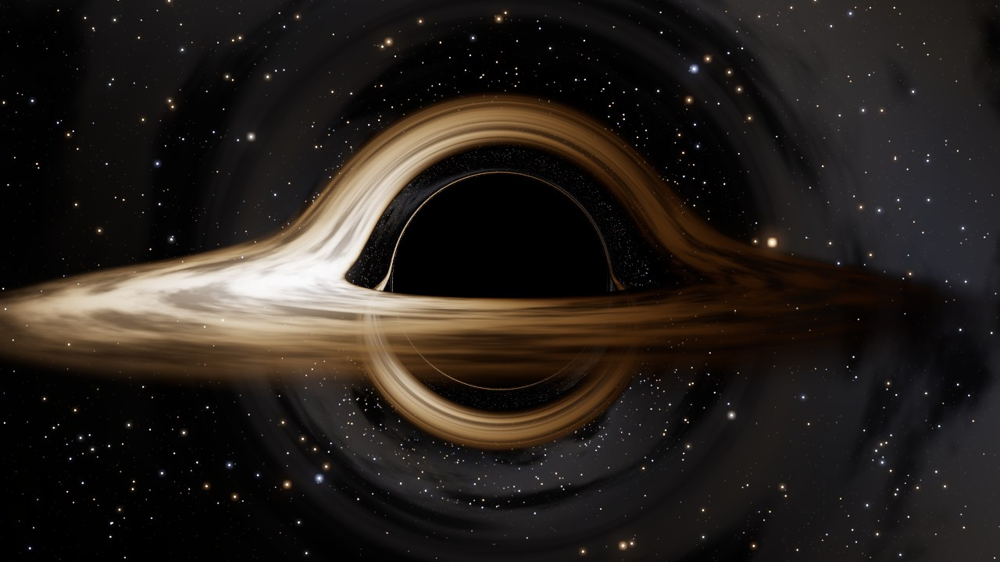
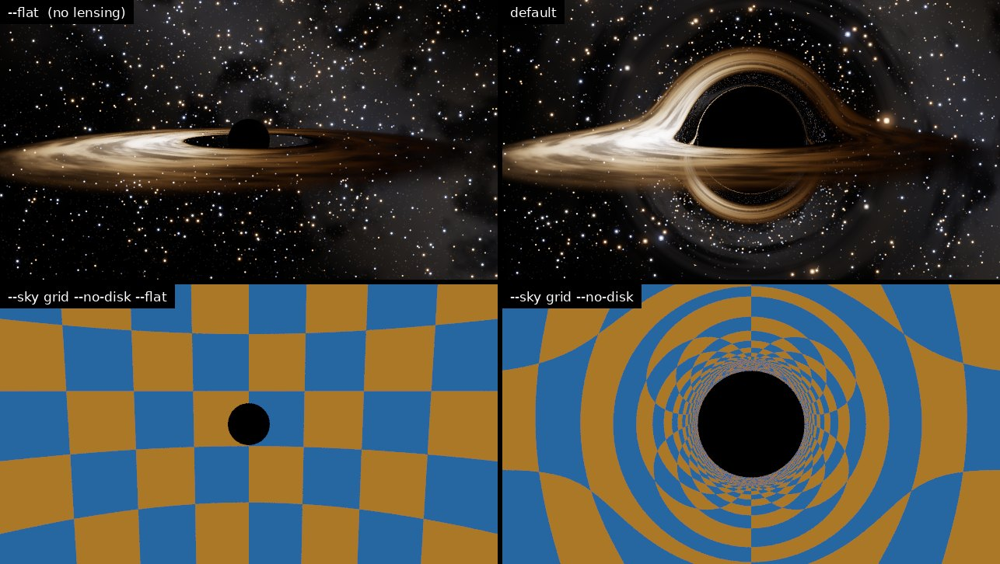
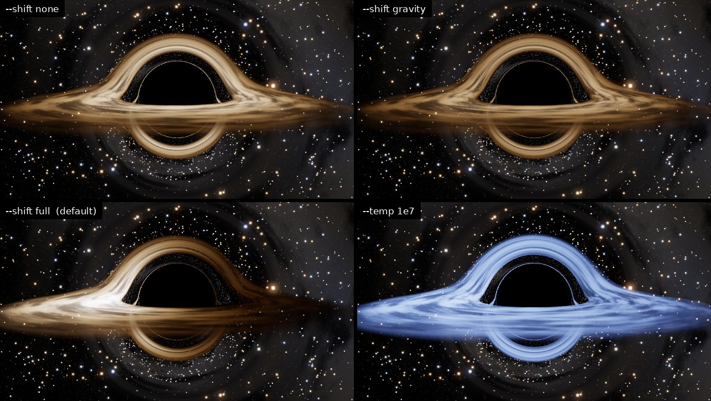
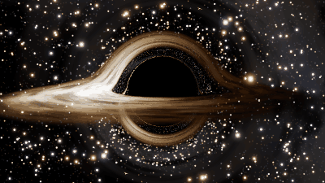

# Black hole simulation in C++



A single-file C++17 program that ray-traces a non-rotating (Schwarzschild)
black hole with a thin accretion disk and a starry sky behind it.

Nothing in the picture is painted in. The program follows each pixel's light
ray along its curved path through the spacetime of general relativity. The
shadow, the disk bent over and under the hole, the thin photon ring and the
lop-sided brightness all come out of that one calculation.

It has no dependencies beyond the C++ standard library. It uses every CPU
core and writes PNG or PPM.

## Build and run

```sh
g++ -O3 -std=c++17 -pthread blackhole.cpp -o blackhole    # or just: make
./blackhole              # writes blackhole.png, 1280x720, ~20 s on 4 cores
./blackhole --test       # checks the integrator against exact GR results
./blackhole --help       # all the options
```

On Windows: `cl /O2 /std:c++17 /EHsc blackhole.cpp` (MSVC), or the same `g++`
line with MinGW.

On start-up it prints the real sizes for the mass you choose. They default to a
10-solar-mass hole; `--mass 4.3e6` gives Sagittarius A\*:

```
Schwarzschild black hole of 10 solar masses (M = GM/c^2 = 14.77 km)
  event horizon    r = 2M      =      29.53 km
  photon sphere    r = 3M      =       44.3 km
  ISCO             r = 6M      =       88.6 km   orbit 0.00455 s at 0.50c
  shadow edge      b = 3sqrt3 M =     76.73 km
  camera at        r = 30M = 443 km, sees the shadow 19.27 deg across
```

## What you are looking at

- **The shadow.** Any light ray aimed closer than 3√3 M ≈ 5.2 M (impact
  parameter) spirals into the hole. So the black disk is 2.6 times wider than
  the event horizon itself.
- **The photon ring.** This is the thin bright line hugging the shadow. It is
  light from the disk that swung around the hole, close to the photon sphere at
  r = 3M, at least half an orbit before reaching us.
- **The arc over the top.** This is the far side of the disk, which is really
  behind the hole. Its light is bent up over the top towards the camera. The
  arc under the bottom is the *underside* of the same far side, bent underneath.
- **Left bright, right dim.** At the inner edge the gas orbits at half the
  speed of light. The side coming towards us is Doppler-shifted bluer and
  beamed much brighter, and the side moving away is redder and fainter.
- **Gravitational redshift.** Light loses energy climbing out of the hole, so
  the inner disk looks cooler and dimmer than it really is.
- **The stars.** Background stars are lensed too. Around the Einstein ring,
  about 21° from the hole at this distance, they are magnified and appear
  twice. Just outside the shadow, the entire sky is squeezed into a thin,
  crowded band.

## Comparisons



Top row: the same scene with light travelling in straight lines (`--flat`) and
with light bent by gravity. Bottom row: the sky replaced by a 10° checkerboard
(`--sky grid --no-disk`), without and with gravity. With gravity you can see the
Einstein ring and the copies of the whole sky stacked up towards the shadow.



`--shift none` draws the disk as it would look with no frequency shifts.
`--shift gravity` adds only gravitational redshift. `full` (the default) also
includes the orbital motion, which gives the Doppler beaming. With
`--temp 1e7`, the disk is as hot as real disks around stellar black holes. A
blackbody that hot looks blue-white whatever its exact temperature. Its
visible brightness then only scales like g rather than g⁴, so the asymmetry is
milder.



`--frames 40 --frame-dt 4` writes an animation, one PNG per frame. The gas
moves on Kepler orbits (Ω = √(M/r³)), so the inner disk turns faster than the
outer disk and the clumps shear out into streaks. To make a video:
`ffmpeg -framerate 30 -i blackhole_%04d.png -pix_fmt yuv420p disk.mp4`.

## How it works

**Units.** G = c = M = 1, so lengths are in units of GM/c² (1.48 km per solar
mass) and times in GM/c³ (4.9 µs per solar mass). The horizon is at r = 2, the
photon sphere at r = 3, and the innermost stable circular orbit (ISCO) at r = 6.
In these units the picture is the same for any mass; only the scale changes.

**Bending light.** Around a Schwarzschild black hole, light moves in a plane,
and its orbit u(φ) = 1/r obeys

    d²u/dφ² + u = 3M u²

Without the right-hand side, the solution is a straight line, so all of
general relativity's light bending lives in that 3Mu² term. The program
integrates the equivalent 3-D equation

    d²x/dλ² = −3M |h|² x / |x|⁵,      h = x × dx/dλ (conserved)

This is a central force whose orbits satisfy exactly the equation above (by
Binet's formula). Working in plain Cartesian coordinates means there are no
pole singularities. Rays are stepped with 4th-order Runge–Kutta, using steps of
about 3% of r. Steps get longer far out, where a nearly radial ray hardly bends.

**The camera.** The camera hovers at a fixed radius, and each pixel is a
direction in the camera's own frame. A ray leaving at angle α from the radial
direction has impact parameter b = r sin α / √(1 − 2M/r). In the Cartesian
model that is the same as shrinking the radial part of the direction by
√(1 − 2M/r).

**The disk.** The disk is thin and lies in the equatorial plane, from the ISCO
out to 20M. Its temperature follows the thin-disk profile
T ∝ r^(−3/4) (1 − √(r_in/r))^(1/4). The gas moves on circular geodesics. The
ratio of observed to emitted frequency is

    g = √(1 − 3M/r) / ( √(1 − 2M/r_cam) · (1 − Ω b_φ) )

where b_φ is the photon's angular momentum per unit energy about the disk axis.
This one factor combines gravitational redshift, time dilation and the Doppler
shift. Because I_ν/ν³ is conserved along a ray, a blackbody at temperature T
seen with shift g is exactly a blackbody at temperature gT. So the observed
colour is a Planck spectrum integrated against the CIE 1931 colour-matching
functions and converted to sRGB. Turbulent clumps (fractal noise) ride along
with the orbiting gas.

**Stars.** Stars are points, so lensing can move them and brighten or dim them,
but not smear them. For every pixel, a ray through its centre and two more a
quarter of a pixel away give the Jacobian J of the map from image to sky. Each
star is drawn as a sharp dot where it lands, with its brightness multiplied by
the magnification |det J_flat| / |det J|. The *Interstellar* team handled
stars in the same spirit, following the shape of a whole ray bundle.

**The image.** The renderer adds a little bloom around bright light, then uses
filmic (ACES) tone mapping and the sRGB curve. A tiny built-in PNG writer
stores the pixels uncompressed, so there is no zlib dependency. The files are
large; convert them if size matters.

## Accuracy

`./blackhole --test` compares the integrator with exact results:

- the angular size of the shadow seen by a static observer (Synge's formula),
  which tests the camera model as well as the geodesics,
- the bending angle of light against the exact integral
  α = 2∫₀^{u₀} du / √(1/b² − u² + 2Mu³) − π,
- conservation of the invariants on a ray that whirls round the photon sphere.

```
Angular radius of the shadow (static observer):
  r =   4.0 M   traced  66.71627 deg   exact  66.71627 deg   rel. error 1.4e-08  ok
  r =  30.0 M   traced   9.63273 deg   exact   9.63273 deg   rel. error 1.9e-08  ok
  r = 100.0 M   traced   2.94856 deg   exact   2.94856 deg   rel. error 2.2e-08  ok
  ...
Deflection of a ray with closest approach r0:
  r0 =    3.2 M  b =    5.226 M   traced   4.788497 rad   exact   4.788490 rad   rel. error 1.6e-06  ok
  r0 =    6.0 M  b =    7.348 M   traced   1.014876 rad   exact   1.014875 rad   rel. error 1.9e-07  ok
  r0 = 1000.0 M  b = 1001.002 M   traced   0.004008 rad   exact   0.004008 rad   rel. error 4.4e-06  ok
  (weak field: Einstein's 4M/b = 0.003996 rad for b = 1001.0 M)
  ...
Conservation along a ray that orbits the photon sphere:
  swept 3.0 turns; drift of |h| 6.5e-09  ok; of |v|^2 - 2M h^2/r^3 2.0e-07  ok

All checks passed.
```

## Options

| Option | Default | Meaning |
|---|---|---|
| `-o FILE` | `blackhole.png` | output image, `.png` or `.ppm` |
| `--width N`, `--height N` | 1280, 720 | image size in pixels |
| `--fov DEG` | 48 | vertical field of view |
| `--dist R` | 30 | camera distance from the hole, in M |
| `--incl DEG` | 84 | angle between line of sight and disk axis: 90 edge-on, 0 face-on |
| `--azimuth DEG` | 0 | camera position around the axis |
| `--disk-in R`, `--disk-out R` | 6, 20 | disk edges, in M (inner edge must be > 3) |
| `--temp K` | 4500 | peak disk temperature, in the gas's own frame |
| `--no-disk` | | just the hole and the sky |
| `--sky stars\|grid\|none` | `stars` | background |
| `--shift full\|gravity\|none` | `full` | which frequency shifts to apply |
| `--flat` | | light travels in straight lines (no lensing) |
| `--exposure X` | 1 | brightness multiplier before tone mapping |
| `--aa N` | 2 | N×N samples per pixel |
| `--no-bloom` | | no glow around bright light |
| `--step F` | 0.03 | integration step, as a fraction of r |
| `--frames N` | 1 | render an animation of N frames |
| `--frame-dt T` | 1.5 | time between frames, in GM/c³ |
| `--orbit DEG` | 0 | how far the camera circles during the animation |
| `--threads N` | all cores | worker threads |
| `--mass MSUN` | 10 | mass used for the printed physical sizes |
| `--test` | | run the self-test and exit |

Some views to try:

```sh
./blackhole --incl 25                         # nearly face-on
./blackhole --dist 12 --fov 80                # up close
./blackhole --sky grid --no-disk              # pure lensing
./blackhole --frames 120 --orbit 360          # fly once around the hole
```

## Simplifications

- The hole does not spin. A spinning (Kerr) hole would flatten one side of the
  shadow and let the disk reach further in.
- The disk is infinitely thin and each ring of it shines as a blackbody. The
  temperature profile is the Newtonian thin-disk form; the full relativistic
  (Page–Thorne) profile adds correction factors that are left out here.
- The default temperature, 4500 K, is chosen so that the colour shifts show.
  Real disks reach about 10⁷ K around stellar-mass holes (they shine in X-rays)
  and about 10⁵ K around supermassive ones.
- Each animation frame is a snapshot at one instant. The time light takes to
  cross the scene is ignored.
- The camera hovers in place. Doing that so close to a black hole would take a
  very powerful rocket.

## References

- J.-P. Luminet, *Image of a spherical black hole with thin accretion disk*,
  Astron. Astrophys. 75, 228 (1979): the first such picture, drawn by hand from
  computer output.
- O. James, E. von Tunzelmann, P. Franklin, K. S. Thorne, *Gravitational
  lensing by spinning black holes in astrophysics, and in the movie
  Interstellar*, Class. Quantum Grav. 32, 065001 (2015).
- J. L. Synge, *The escape of photons from gravitationally intense stars*,
  MNRAS 131, 463 (1966).
- D. N. Page, K. S. Thorne, *Disk-accretion onto a black hole*, ApJ 191, 499
  (1974).
- C. Wyman, P.-P. Sloan, P. Shirley, *Simple analytic approximations to the
  CIE XYZ color matching functions*, JCGT 2(2), 1 (2013).
