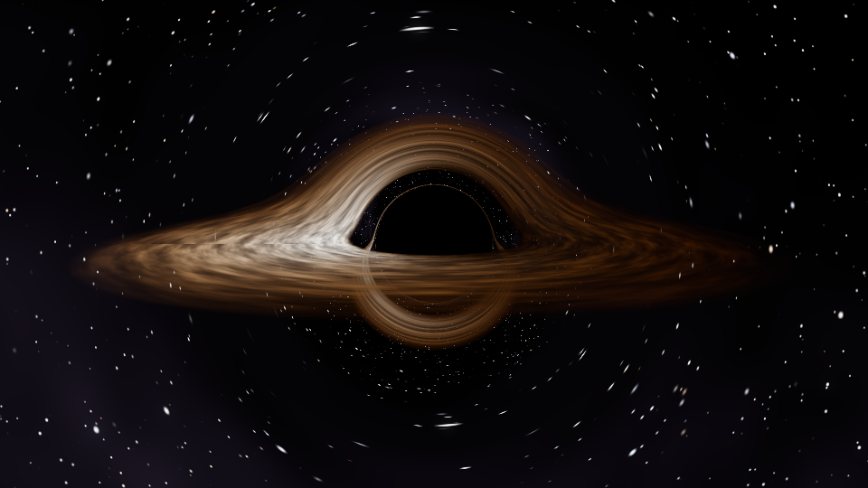

# Black hole simulation in C

A ray tracer for a non-rotating (Schwarzschild) black hole with a thin accretion disk. It is written in plain C with no dependencies (OpenMP is optional).



## What it simulates
- **Light bending.** Each ray is traced backwards along a null geodesic, integrated with RK4 using `a = -1.5·h²·x/r⁵` (units where r_s = 1).
- **Event horizon and photon ring.** Rays that cross r < r_s are captured. The thin bright ring near the shadow comes from light that loops around the hole.
- **Accretion disk.** It runs from the ISCO (3 r_s) out to 14 r_s, with a Shakura–Sunyaev temperature profile and procedural turbulence.
- **Relativistic effects.** The disk includes Doppler shift, beaming (I ∝ g⁴) and gravitational redshift, so the side moving toward the camera is brighter.
- **Gravitational lensing.** The far side of the disk appears above and below the shadow, and the background starfield is distorted.

## Build & run
```sh
make                       # or: gcc -O3 -fopenmp -o blackhole blackhole.c -lm
./blackhole                # writes blackhole.ppm (1280x720)
./blackhole -i 3 -d 25 -w 1920 -h 1080 -s 9 -o hd.ppm
./blackhole -n 60 -w 640 -h 360        # orbit animation: frame_000.ppm ...
convert -delay 4 frame_*.ppm orbit.gif # (ImageMagick) turn frames into a GIF
```

Options: `-w/-h` size, `-i` inclination above the disk (degrees), `-a` azimuth, `-d` camera distance (in r_s), `-f` field of view, `-s` samples per pixel, `-n` frames, `-o` output file.
